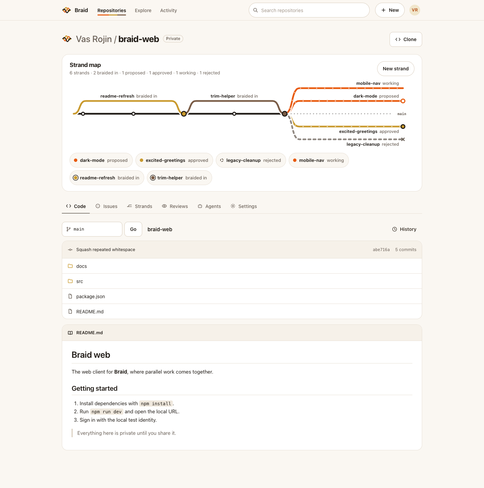

# Braid

**Where parallel work comes together.**

Braid is a Git forge built for many agents and people changing the same codebase at once. Every task, and every agent, works on its own **strand**: a private fork pinned to an exact starting commit. Work comes back as an exact, reviewable proposal. Braid weaves those strands back into one clean history with a fenced merge that stays safe however many changes race at once. It runs entirely on Cloudflare: Workers, Artifacts, Durable Objects, Containers, D1, R2 and Workers AI.

Live: **https://gitflare.lintlabs.org** (sign in with GitHub) · [Vision](docs/vision.md) · [Feature and verification matrix](docs/implementation.md) · [Security model](docs/security.md)



## What you can do

- **Sign in with GitHub and bring your work.** Connect your account, then import one repository or all of your public repositories with full history, branches and tags. Imports are private until you share them.
- **Branch into strands.** Each strand is a private fork of the repository, pinned to a base commit. People push to it with ordinary `git` and short-lived, strand-scoped credentials.
- **Propose and review.** A proposal names an exact base and candidate commit. Reviewers see a readable diff, discuss it, and approve or reject it.
- **Braid in safely.** Merging publishes the candidate only if the repository head is still the proposal's base. When changes race, exactly one lands and the rest are told to catch up, so nothing is silently overwritten.
- **Hand a goal to an agent.** From a repository's **Agents** tab, describe a change. Braid creates a strand, starts an isolated Cloudflare Container, runs a durable [Pi](https://earendil.com/posts/pi-durable/) coding agent on Workers AI, and the agent commits, pushes and opens a proposal for your review. Git credentials never enter the container.
- **Run a swarm.** Give one goal to 2–3 agents. A planner splits it into non-overlapping sub-tasks, and each agent works on its own strand in parallel. When one change is braided in, the others become stale; each stale agent **catches up** by rebasing its work onto the new history (resolving conflicts itself) and re-proposing, so every change still lands through the same fence.
- **See the braid.** Every repository shows a live strand map: what is being worked on, what is proposed, and what has been braided in.
- Issues, collaborators and email invitations, repository search and discovery, contribution activity, and Git LFS with content-defined chunk deduplication on R2.

## How it is built

| Concern | Cloudflare primitive |
|---|---|
| Git storage, forks (strands), clone/push | Artifacts |
| API, UI, auth gate, Git credential issuing | Workers |
| Agent runs, run registry, review jobs | Durable Objects (SQLite) |
| Agent sandbox | Containers (`durable_object` scheduling, managed Debian image) |
| Agent model | Workers AI (`@cf/openai/gpt-oss-120b`) via Pi Durable |
| Catalog: repos, grants, proposals, issues | D1 |
| LFS objects | R2 |
| Identity | WorkOS AuthKit (GitHub sign-in) |

Agent runs are journaled, so an interrupted run resumes without pushing twice or opening a duplicate proposal. Outbound HTTPS from the container to Artifacts is intercepted, and a fresh 60-second token scoped to that one strand is minted per request. Every agent step rechecks the user's session and write access.

## Run it locally

Node ≥ 22.15, Git, and a Chromium for the UI harnesses.

```sh
npm ci
npm run typecheck
npm test                         # unit, contract and local-workerd tests
npm run dev                      # loopback-only local harness with a test identity
npm run test:ui:core             # 1440px browser journeys on real local Git
npm run test:ui:mobile           # the same at 390px
WRANGLER_SEND_METRICS=false npm run build   # Worker dry run
```

The local harness uses real bare Git repositories, SQLite and a filesystem object store, with an explicit local identity that the production bundle never accepts. Containers and Artifacts only run in a deployed Worker.

## Limits worth knowing

- Imports follow Artifacts' limits: 32 MB per file and 1 GB per repository. Repositories over those limits are refused with nothing partially imported.
- Agents run with no general Internet access inside the container, so goals that need package downloads or network calls will fail. Each run is bounded (15 model requests, 20 minutes, 120 seconds per command), with per-repository and daily caps.
- Large-file LFS uploads to R2 need bucket-scoped signing credentials that are not configured on the live deployment.

Detailed, dated verification evidence for each feature lives under [`docs/`](docs/implementation.md).
