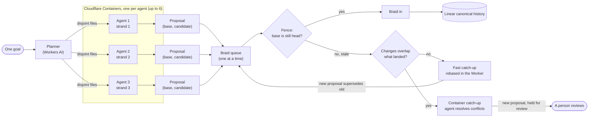
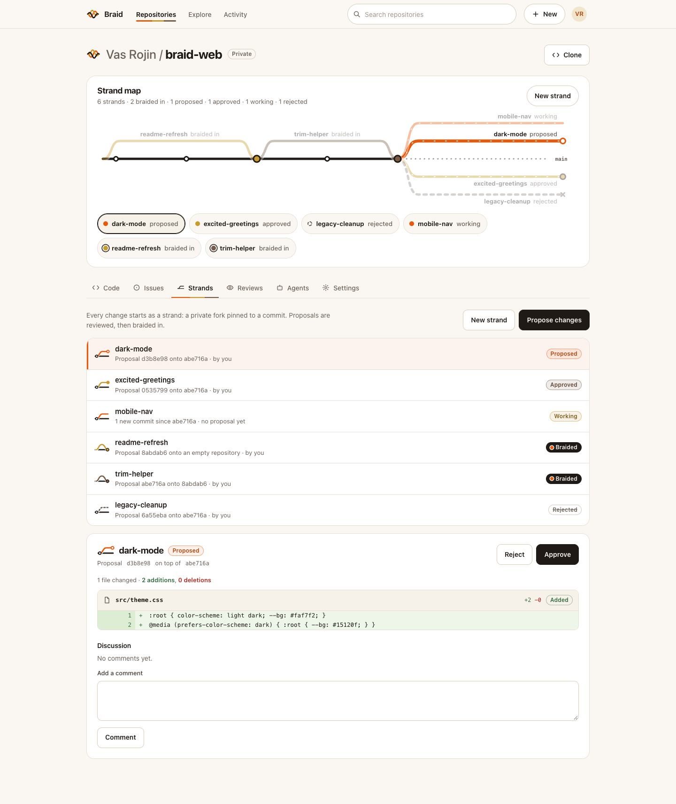
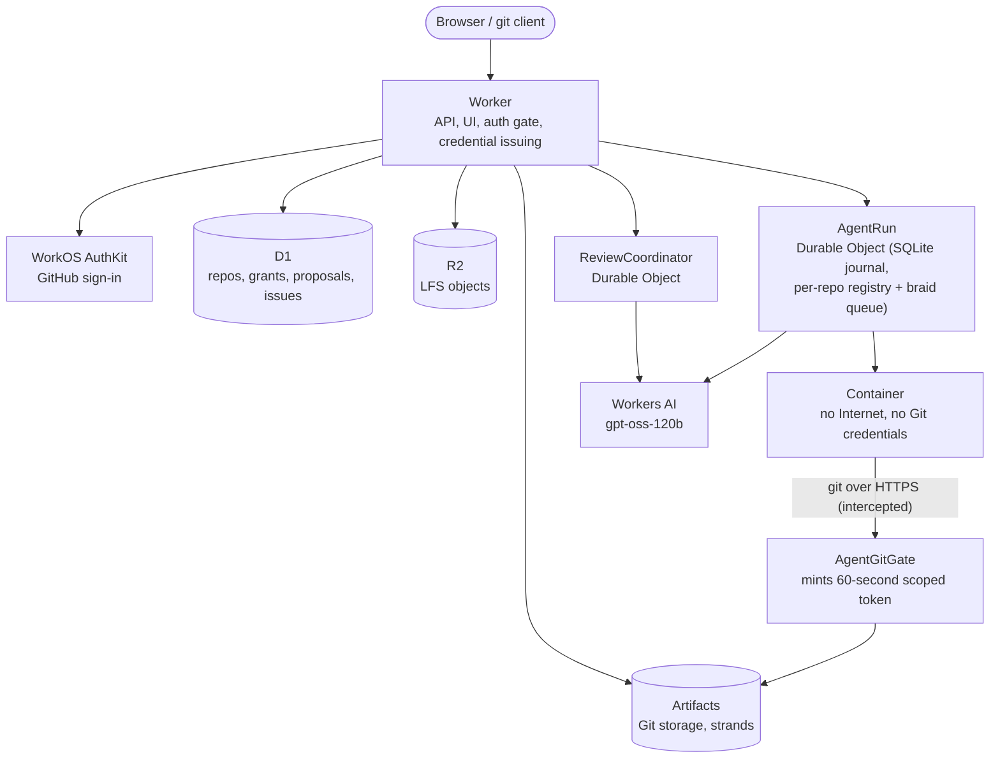

<p align="center">
  
  
  
</p>

<h1 align="center">Braid</h1>

<p align="center">
  <strong>Where parallel work comes together.</strong>
</p>

<p align="center">
  A Git forge built for many agents and people changing the same codebase at once,<br>
  running entirely on Cloudflare.
</p>

<p align="center">
  <a href="https://gitflare.lintlabs.org"><strong>Live site</strong></a> ·
  <a href="docs/vision.md">Vision</a> ·
  <a href="docs/implementation.md">Feature and verification matrix</a> ·
  <a href="docs/security.md">Security model</a>
</p>

<p align="center">
  <sub>The live site at <code>gitflare.lintlabs.org</code> is private: sign in with GitHub through WorkOS AuthKit.</sub>
</p>

<p align="center">
  <picture>
    <source media="(prefers-color-scheme: dark)" srcset="docs/ui-braid/1440-repo-strand-map-dark.png">
    
  </picture>
</p>

---

## Why Braid

**Agents scale. Human attention doesn't.** When a repository has far more agents than reviewers, a pull-request queue turns people into the bottleneck. In Braid, every task gets its own strand, every change carries its own evidence, and the repository's policy decides which changes need a person. See the [vision](docs/vision.md).

Shared branches and pull-request queues were designed for a handful of humans. When many agents push at once, they collide on the same refs, review context goes stale, and merges race. Braid assumes concurrency from the start:

- **One strand per task.** Every task, and every agent, works on its own **strand**: a private fork pinned to an exact starting commit. Nobody shares a branch.
- **Immutable proposals.** Work comes back as an exact `(base, candidate)` pair, so review is always about precisely what will land.
- **A fence on every merge.** Braiding in publishes the candidate only if the repository head is still the proposal's base. When changes race, exactly one lands and the rest are told to catch up, so nothing is silently overwritten.
- **Agents that catch up on their own work.** When something lands, every stale agent proposal catches up automatically. Changes that don't overlap are rebased inside the Worker in about a second, with no container. Real conflicts go to the agent in a Cloudflare Container to resolve. Either way the result comes back as a fresh proposal through the same fence.
- **A braid queue instead of a merge race.** Queued proposals are braided in one at a time. Only the proposal at the front is caught up, so N parallel strands cost N rebases, not N². Swarms can opt in to auto-braid their clean parts.

## How a swarm comes together



1. A **planner** (one Workers AI request) splits one goal into 2–6 sub-tasks that each own a disjoint set of files. If the plan overlaps or is malformed, nothing starts.
2. Each sub-task becomes an ordinary **agent run**: a Pi Durable coding loop on Workers AI (`@cf/openai/gpt-oss-120b`), in its own Cloudflare Container, on its own strand.
3. Each agent commits, pushes to its strand, and opens an **immutable proposal**.
4. Proposals enter the **braid queue**: a person queues them ("Braid in when ready"), or, for a swarm started with **auto-braid**, each part joins as soon as it is proposed. Once one is braided in, the rest are stale, and the **fence** refuses to braid them because the head moved.
5. The queue **catches up** only the proposal at the front. If its change doesn't overlap what landed, the Worker rebuilds the commit on the new head and pushes it in about a second (**fast catch-up**). Otherwise a fresh container rebases it and the agent resolves the conflicted files, with a bounded budget. The result is proposed again and the old proposal is marked superseded.
6. Auto-braid lands a part only if it stays inside the files the planner gave it and nothing needed conflict resolution. Anything else is held for a person. Every change lands through the same fence, so history stays linear.

## How it works

| Term | Meaning |
|---|---|
| **Strand** | A private task fork of the canonical repository, pinned to a base commit. People push to it with ordinary `git` and short-lived, strand-scoped credentials. |
| **Proposal** | An immutable `(base, candidate)` pair of exact commits, with a readable diff, discussion, and approve/reject review. |
| **Fence** | The check at merge time: the candidate is published only if the canonical head still equals the proposal's base. Exactly one racing proposal can win. |
| **Braid in** | Merging an approved proposal through the fence into the canonical history. |
| **Catch up** | Rebasing a stale proposal onto the current head (`git rebase --onto <new head> <old base>`), resolving conflicts with the agent if needed, then proposing again. The new proposal supersedes the old one. Runs automatically when something lands. |
| **Fast catch-up** | A catch-up done inside the Worker, with no container: when a one-commit change touches different paths from what landed, Braid rebuilds the trees and commit, checks every tree it reads against its known hash, and pushes a small pack. Overlaps fall back to the container. |
| **Braid queue** | A per-repository line of proposals braided in one at a time, each caught up first if needed. Only the front is caught up, so N strands cost N rebases. |
| **Swarm** | One goal split by the planner into 2–6 non-overlapping sub-tasks, each an agent run on its own strand. With **auto-braid**, clean parts are braided in from the queue without a click. |
| **Strand map** | The per-repository view of history as a line, with strands branching off at their base and looping back in when braided. |

## Features

**Collaboration**
- Sign in with GitHub, then import one repository or all of your public repositories with full history, branches and tags. Imports are private until you share them.
- Branch into strands, propose, review with diffs and discussion, and braid in through the fence, or choose **Braid in when ready** to let the braid queue catch it up and braid it in for you.
- Issues, collaborators and email invitations, repository search and discovery, and contribution activity.
- Git LFS on R2 with content-defined chunk deduplication.
- A live strand map on every repository: what is being worked on, what is proposed, and what has been braided in.

**Agents**
- From a repository's **Agents** tab, describe a change. Braid creates a strand, starts an isolated Cloudflare Container, runs a durable [Pi](https://earendil.com/posts/pi-durable/) coding agent on Workers AI, and the agent commits, pushes and opens a proposal for your review.
- **Start a swarm** with 2 to 6 agents working in parallel on one goal, with live per-sub-task status and braid-queue position.
- **Auto-braid** (admins): a swarm's clean parts are braided in one at a time without a click. A part that strays outside its planned files, or whose conflicts the agent had to resolve, is held for review.
- **Catch up** happens automatically after every braid-in, in the Worker when the changes don't overlap and in a container when they do. It also runs in place when an agent's own proposal is refused as stale while it was working. A manual **Catch up** button remains.
- Agent runs are journaled, so an interrupted run resumes without pushing twice or opening a duplicate proposal.
- A bounded, read-only Pi reviewer can inspect proposals.

<p align="center">
  <picture>
    <source media="(prefers-color-scheme: dark)" srcset="docs/ui-braid/1440-strands-diff-dark.png">
    
  </picture>
</p>

## Architecture



| Concern | Cloudflare primitive |
|---|---|
| Git storage, forks (strands), clone/push | Artifacts |
| API, UI, auth gate, Git credential issuing | Workers |
| Agent runs, run registry, braid queue, review jobs | Durable Objects (SQLite): `AgentRun`, `ReviewCoordinator` |
| Agent sandbox | Containers (`durable_object` scheduling, managed Debian image) |
| Agent model | Workers AI (`@cf/openai/gpt-oss-120b`) via Pi Durable |
| Catalog: repos, grants, proposals, issues | D1 |
| LFS objects | R2 |
| Identity | WorkOS AuthKit (GitHub sign-in) |

## Security model

- **Containers never hold Git credentials.** Outbound HTTPS from the container to Artifacts is intercepted by an outbound gate, which mints a fresh 60-second token scoped to that run's strand per request. `git-receive-pack` (push) is allowed only during the push step; catch-up may also *read*, never write, the canonical repository.
- **No general Internet in the container.** Package installs go through an intercept that only passes GET/HEAD to `deb.debian.org` and is closed right after install.
- **Access is rechecked continuously.** Every agent phase and every model request rechecks the user's live session, organization membership and write access; losing access stops the run before any push or proposal.
- **Nothing lands without a person's say-so.** Agents open proposals. A person approves and braids them in, or queues them. Auto-braid is an admin opt-in per swarm, acts with that admin's live-rechecked authority (cached for at most 60 seconds), and only lands parts that stay inside their planned files without agent-resolved conflicts.
- **Fast catch-up fails closed.** Every tree the Worker reads is re-encoded and must hash to its known id before anything is changed. Overlapping paths are never merged in the Worker, and the pushed commit still passes the strand's and the canonical repository's own checks.

Details: [docs/security.md](docs/security.md).

## Quick start

Requirements: Node ≥ 22.15, Git, and a Chromium for the UI harnesses.

### Run locally

```sh
npm ci
npm run typecheck
npm test                         # unit, contract and local-workerd tests
npm run dev                      # loopback-only local harness with a test identity
npm run test:ui:core             # 1440px browser journeys on real local Git
npm run test:ui:mobile           # the same at 390px
```

The local harness uses real bare Git repositories, SQLite and a filesystem object store, with an explicit local identity that the production bundle never accepts. Containers and Artifacts only run in a deployed Worker.

### Build and deploy

```sh
WRANGLER_SEND_METRICS=false npm run build   # Worker dry run into dist/
npm run deploy                              # wrangler deploy --containers-rollout=immediate
npm run test:worker                         # Worker authentication smoke test
npm run test:deployed                       # deployed denial checks
```

Deploy with `npm run deploy`, not a plain `wrangler deploy`. `AgentRun` is a container-enabled Durable Object class that also hosts each repository's braid queue, and the default container rollout updates only 10% of instances at first, which would leave stale queue code running.

Bindings (Artifacts, D1, R2, Workers AI, Durable Objects, Containers) and non-secret variables live in [`wrangler.jsonc`](wrangler.jsonc); D1 migrations are in [`migrations/`](migrations). Secrets are installed through Wrangler stdin by [`scripts/configure-core-secrets.py`](scripts/configure-core-secrets.py) (`WORKOS_API_KEY`; `--github` for the GitHub client; `--r2` for bucket-scoped R2 signing keys). See [docs/implementation.md](docs/implementation.md) for the full setup.

## Limits worth knowing

- Imports follow Artifacts' limits: 32 MB per file and 1 GB per repository. Repositories over those limits are refused with nothing partially imported.
- Agents run with no general Internet access inside the container, so goals that need package downloads or network calls will fail. Each run is bounded (15 model requests, 20 minutes, 120 seconds per command), with per-repository and daily caps: at most 6 active runs per repository, 20 runs per repository per day, 60 per day for the deployment.
- Catch-up conflict resolution is bounded: at most 6 extra model requests, 3 rebase rounds, and 6 catch-ups per run. Fast catch-up handles one-commit changes of up to 2,000 files and 600 directories read.
- Large-file LFS uploads to R2 need bucket-scoped signing credentials that are not configured on the live deployment.

## Scale

Measured on the live deployment on 2026-10-10, with the harness in [`scripts/scale/`](scripts/scale). Each strand is a real Artifacts fork, each push is real `git` over HTTPS, and every braid-in goes through the fence.

**Real agents: a 6-agent swarm with auto-braid**

| | |
|---|---|
| Agents in parallel | 6, each in its own Cloudflare Container on its own strand |
| Start → every part pushed | 51–64 s |
| Start → all 6 braided in, no clicks | **113 s** |
| Catch-ups needed | 9, **all fast** (in the Worker, 2.4–2.9 s each); 0 containers needed for catching up |
| Result | 6 commits on a linear history, each inside its planned file |

**Braid queue under load** (synthetic strands, one file each, all proposed on the same base, then queued at once)

| Strands | Braided in | Integration time | Per braid-in | Notes |
|---:|---:|---:|---:|---|
| 20 | 18 / 18 | 37 s | ~2.0 s | 17 rebased in the Worker first |
| 50 | 48 / 48 | 123 s | ~2.6 s | linear history, nothing held |
| 100 | 99 / 99 | 282 s after queuing (354 s including queuing) | ~2.9–3.6 s | every strand's file present in the final tree |

Without the queue, N parallel strands would need about N²/2 rebases, because every braid-in makes every other proposal stale. The queue only catches up the front entry, so it needs at most N.

**The fence under contention**

| Concurrent braid-ins of fresh, approved proposals | Winners | Refused |
|---:|---:|---:|
| 17 | 1 | 16 ("Another publisher holds the fence") |
| 30 | 1 | 29 (fence, or a publish already in flight) |

Three strands editing the same file: the first is braided in, the other two are **held** ("Overlaps what landed (scale/shared.txt)") instead of being merged blindly.

**Strands and pushes**: 100 strands created 8 at a time in ~70 s (p50 4.2 s per fork). 100 pushes, 16 at a time, in ~9 s (p50 1.3 s).

**Found and fixed by these runs**
- Proposal lookups read an arbitrary 100 rows, so past 100 proposals the queue couldn't find new ones. Lookups now go by id, and lists return the newest 100.
- Artifacts `fork` intermittently returns `INTERNAL_ERROR` at 20–30 concurrent forks of one repository (about 10%), even though the fork went through. Braid retries with backoff and treats a retry's `ALREADY_EXISTS` as done; the strand's refs are still checked against the source snapshot. The failure rate went from ~10% to 0–1%.
- The default container rollout left 90% of `AgentRun` instances on old code after a deploy, so deploys now use `--containers-rollout=immediate`.

**Design limits, honestly**
- Integration is serial **per repository**: about 17–30 braid-ins a minute, roughly 25,000–40,000 a day. Each repository has its own queue in its own Durable Object, so separate repositories integrate in parallel without sharing a bottleneck. Raising one repository past one braid-in at a time needs **braid trains** (see the roadmap).
- Agent concurrency is capped by budget, not architecture: 6 active runs per repository, 20 per repository per day, 60 per day for the deployment. Each run is a container plus up to 15 Workers AI requests.
- Fast catch-up covers one-commit changes that don't overlap what landed. Multi-commit or overlapping changes use a container (about a minute to boot and install git).
- List views are bounded: the newest 100 proposals and repositories, 50 commits of history, 50 strands in the strand map.

## Status and roadmap

- [x] Strands, immutable proposals, review, fenced braid-in
- [x] GitHub sign-in and full-history import
- [x] Single coding agents in Cloudflare Containers
- [x] Swarms of 2–6 agents with a disjoint-file planner
- [x] Catch up: container rebase with agent conflict resolution
- [x] Braid queue with automatic catch-up, Worker-side fast catch-up for disjoint changes, and opt-in auto-braid for swarms
- [ ] Braid trains: rebase and publish a batch of queued, non-overlapping proposals in one fenced push, to raise per-repository throughput past one braid at a time

Detailed, dated verification evidence for each feature lives under [`docs/`](docs/implementation.md).

## Project layout

| Module | Responsibility |
|---|---|
| [`src/main.ts`](src/main.ts) | Deployed entry point; links the agent runtime |
| [`src/worker.ts`](src/worker.ts) | Worker fetch handler and environment bindings |
| [`src/app.ts`](src/app.ts) | API routes, authorization, strands (`createTask`) and proposals (`openProposal`) |
| [`src/auth.ts`](src/auth.ts) | WorkOS AuthKit sessions, JWT verification, cookies |
| [`src/github.ts`](src/github.ts) | GitHub account connection and repository import |
| [`src/agents.ts`](src/agents.ts) | Coding agent engine: phases, container execution environment, catch-up |
| [`src/agent-run.ts`](src/agent-run.ts) | `AgentRun` Durable Object, container and outbound Git gate |
| [`src/swarm.ts`](src/swarm.ts) | Swarm planner, plan validation and status view |
| [`src/queue.ts`](src/queue.ts) | Braid queue decisions: braid, catch up, follow, wait or hold |
| [`src/rebase.ts`](src/rebase.ts) | Fast catch-up: tree diff, overlap check, Git tree/commit/pack encoding |
| [`src/strands.ts`](src/strands.ts) | Strand summary behind the strand map |
| [`src/review.ts`](src/review.ts) | Ancestry checks and diffs |
| [`src/review-coordinator.ts`](src/review-coordinator.ts) | `ReviewCoordinator` Durable Object for review jobs |
| [`src/read-agent.ts`](src/read-agent.ts) | Read-only Pi reviewer and shared Workers AI model wrapper |
| [`src/pi-storage.ts`](src/pi-storage.ts) | SQLite-backed storage for the Pi journal |
| [`src/git-http.ts`](src/git-http.ts) | Git smart HTTP with atomic compare-and-fast-forward |
| [`src/cloudflare.ts`](src/cloudflare.ts) | Artifacts Git plane and R2 object store |
| [`src/catalog.ts`](src/catalog.ts) | D1 catalog interface (also backed by Node SQLite locally) |
| [`src/storage.ts`](src/storage.ts) | LFS storage, hashing and validation helpers |
| [`src/bundle.ts`](src/bundle.ts) | Git bundle import |
| [`src/history.ts`](src/history.ts) | Reachable history and contribution activity |
| [`src/issues.ts`](src/issues.ts) | Issues and comments |
| [`src/contracts.ts`](src/contracts.ts) | Shared types: principals, repos, proposals, merge intents |
| [`src/welcome.ts`](src/welcome.ts) | Public sign-in shell |
| [`web/`](web) | Static UI assets |
| [`test/`](test) | Unit, contract and Git-backed tests |
| [`scripts/`](scripts) | Local harness, UI journeys, smoke tests, benchmarks, setup |

## License

Copyright 2026 Vasanth Sreeram.

Licensed under the [Apache License, Version 2.0](LICENSE).
