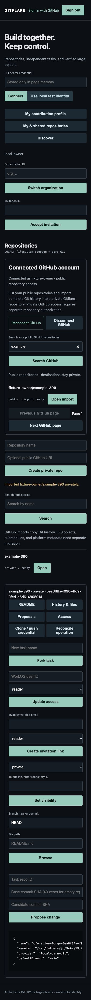
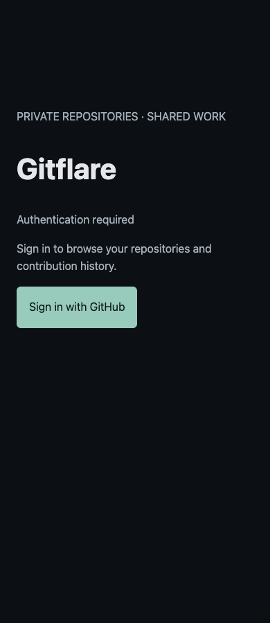

# Gitflare GitHub authentication and import result

GitHub-only sign-in, a connected-account repository picker, and a strict AuthKit session-token verifier are deployed at **https://gitflare.lintlabs.org**. **Real Vas account sign-in and the requested 2–3 app imports remain blocked by human GitHub login and dedicated GitHub OAuth app setup. No end-to-end success is claimed.** The live D1 database has **0 app repositories and 0 connected GitHub accounts** ([read-only count](raw/live-counts.json)).

Baseline `08d18b8` and all earlier benchmark/migration receipts remain retained. Worker deployment version: `e1cbb199-3e4f-4ead-9f4e-c398d639d574` ([deployment](raw/deploy.txt)). The new encrypted-provider-token table was applied only to the existing Gitflare D1 database ([migration](raw/migration.txt)).

## Authentication failure investigation

The earlier key-activation checks established API-key acceptance, a 302 redirect, and a state denial. They did not exchange a real user's authorization code. The reported callback's original token/error trace was unavailable; there was no active recoverable user session. WorkOS's real user record contains an existing Google-linked Vas identity with two historical provider sign-ins, but no GitHub identity. Current authenticated WorkOS session listing returned HTTP 200 with no active sessions. This does not establish a successful prior app code exchange.

Ranked boundaries investigated:

1. **JWT issuer/client contract mismatch:** the baseline verifier compares session access tokens against the client-specific OIDC discovery issuer. The [official AuthKit session-token reference](https://workos.com/docs/reference/authkit/session-tokens/access-token) documents session JWT issuer `https://api.workos.com` and a separate signed `client_id` claim. A signed, nonexpired contract token with that shape fails the baseline verifier with `unexpected "iss" claim value` ([red regression](raw/issuer-red.txt)). This is a confirmed code/contract defect and a likely explanation for the reported generic callback failure; it is **not a captured reproduction of Vas's original live callback**.
2. **PKCE/code exchange:** the app sends S256 authorization challenge and the matching encrypted-cookie verifier during code exchange. The official authentication API contract was reviewed. Contract tests exercise matching verifier, wrong state, failed exchange, and no session issuance on exchange failure. Real user exchange remains unverified.
3. **Provider session lookup:** the actual authenticated API accepts the session-list endpoint. Active-session/user/tenant checks remain present; an inactive or missing session is rejected. Current Vas session listing is empty, so live successful lookup is unverified.

The verifier now uses a separate, pinned `WORKOS_ACCESS_TOKEN_ISSUER=https://api.workos.com`; `WORKOS_ISSUER` retains the exact client OIDC discovery value supplied for Gitflare. RS256/JWKS signature, expiry, issuance age, `sub`, `sid`, signed `client_id`, optional audience, tenant identity, local revocation, actual WorkOS session, user lookup and active organization membership checks remain enforced. It does not accept arbitrary issuers or unsigned identity data. [Green regression](raw/issuer-green.txt).

Callback responses expose only a fixed diagnostic phase (`oauth_state`, `code_exchange`, `login_policy`, `token_verification`, `session_lookup`, `membership_lookup`, `user_lookup`, `github_connection`, `session_sealing`). Tests independently distinguish exchange, token-verification and inactive-session failures without outputting tokens. Production request/cookie/code logging remains disabled. The original reported failure can only be fully confirmed/resolved by a real sign-in after the human step.

## GitHub sign-in and repository access

[WorkOS officially supports GitHub social authentication](https://workos.com/docs/integrations/github-oauth), including optional return of GitHub OAuth tokens. The new login URL pins `provider=GitHubOAuth` and callback requires `authentication_method=GitHubOAuth`. Other methods cannot establish a new app session. Existing session refresh does not apply the new-login method gate; its current signature/session/membership checks remain mandatory. This preservation is contract-tested; there was no active real Google session available to exercise it live.

The dedicated environment `environment_01M3WQ9V3GK4KJ67E7BXDB1YXB` is now configured with GitHub enabled and every other authentication method disabled, retaining email-verification/security/session settings. Only that environment was mutated. [Before](raw/workos-before.json), [operation schemas](raw/workos-operation-schemas.json), [mutation](raw/workos-github-only-mutation.json), [readback](raw/workos-github-only-after.json). Six other environments were compared across 24 configuration reads to the prior verified baseline: unchanged ([isolation](raw/workos-isolation.json)). Team security controls were not changed.

Social identity is separate from repository API authority. The connected account accepts a GitHub token only after validating the WorkOS user/session, comparing the GitHub `/user` ID to the authenticated user's [WorkOS GitHub identity `idp_id`](https://workos.com/docs/reference/authkit/identity/list), and checking the token's available OAuth scopes. Tokens are AES-GCM encrypted in D1 with a separately derived key and origin, audience, WorkOS-user and GitHub-ID bindings. They never appear in session cookies, API responses, Git URLs, frontend storage or Git. Copying another user's ciphertext fails. No app path uses Vas's local `gh` credentials.

The initial connection requests only provider-required email read access, with no extra `repo`, `public_repo`, write, organization or workflow scopes. GitHub [documents public reads without repository scopes](https://docs.github.com/en/apps/oauth-apps/building-oauth-apps/scopes-for-oauth-apps). The picker uses the authorized user's token, independently rechecks `/user`, lists owned public repositories, and offers bounded pagination/search. Search characters cannot inject GitHub qualifiers. It displays account, visibility, fork and current visible import status. Status scans are bounded to 100 readable app repositories. Private source listing/import is disabled until a separate selected-repository authorization design is implemented and explicitly approved; no private permission was requested or inferred here.

Picker imports revalidate the public source against the connected GitHub ID, then use the existing full-history app importer. Owner and tenant come from the real authenticated principal, with private visibility by default. URL import remains available for canonical public GitHub URLs. Repository/tenant/grant authorization continues to protect destination reads. Disconnect removes local authority before attempting GitHub's app-token revocation; failed or unprovable remote revocation provides the GitHub application-settings step. Expired connections require reconnection rather than an invented refresh capability.

## Tests and live boundaries

| Verification | Result and boundary |
|---|---|
| Typecheck / build | Pass ([typecheck](raw/typecheck.txt), [build](raw/build.txt)) |
| Application tests | 45 passed, 0 failed ([tests](raw/tests.txt)); real local Git plus explicitly labeled WorkOS/GitHub provider contract doubles |
| Local workerd authentication | 7 denial checks passed ([receipt](raw/worker-auth-smoke.json)) |
| Existing UI basic / desktop / mobile | 6 / 19 / 19 checks passed; real local Git, local test identity ([basic](raw/ui-basic.json), [1440](raw/ui-1440.json), [390](raw/ui-390.json)) |
| Connected picker UI | 4 groups passed at 390/1440; account, public badge, search/pagination, private app import ownership/status, disconnect and no overflow; **GitHub provider fixtures**, no Vas account ([receipt](raw/ui-picker.json)) |
| Deployed private/auth denials | 18 passed; anonymous/fake identity rejected ([receipt](raw/deployed-core-smoke.json)) |
| Deployed browser | 6 checks passed: TLS, 390/1440 gate, real app GitHub/PKCE redirect and actual GitHub password login form ([receipt](raw/deployed-browser.json)) |
| Vas callback/session/refresh/logout | **Not verified live: human login required** |
| Vas connected repo listing/isolation | **Not verified live: dedicated OAuth app/token return and human consent required**; user isolation/revocation/ACL tested with contract doubles |
| Actual new app imports/browse/history/profile/clone/fetch | **0 imports; not verified live**. No app owner or grant rows fabricated. Earlier Maggie's Farm provider-only migration remains separate. |

The first UI-basic rerun hit a test locator collision between the two repository-name fields. The selector was scoped to the intended textbox and the rerun passed. This was a test locator issue; no authentication success is inferred from it.

Local connected-picker fixture screenshot (not Vas's live account):

Actual deployed anonymous gate:

## Full-history import candidates

These are **preflighted candidates, not imported destinations**. Mirrors were fetched anonymously, with hooks/global Git configuration/LFS smudge disabled. No imported code was executed. All reachable object IDs, commits, source refs before/after, checkout blob hashes/bytes/modes and shallow/LFS/submodule checks are recorded in [preflight](raw/preflight.json).

| Public nonfork source | Commits / objects / checkout files | Reachable uncompressed bytes | Bundle bytes | Largest historical blob |
|---|---:|---:|---:|---:|
| `vasanthsreeram/cloudnee` | 3 / 65 / 43 | 1,118,637 | 984,489 | 930,330 |
| `vasanthsreeram/himaldb` | 17 / 250 / 70 | 1,381,083 | 359,618 | 254,103 |
| `vasanthsreeram/formninja` | 8 / 99 / 48 | 1,926,502 | 1,008,930 | 160,597 |

All are full mirrors, contain no historical LFS pointers or checkout submodules, fit native blob 32 MB/importer 40 MB limits, and retained identical source refs before/after. Their GitHub source repos were never edited or pushed. MFweb-app and That_Aquarium_Webapp remain excluded for oversized historical blobs; no history rewrite, file removal or LFS conversion was attempted. Original SHA/authors/timestamps will be preserved by ordinary Git object transfer, but source/destination object and checkout equality cannot be claimed until real destinations exist.

## Exact human blocker and next action

The in-app browser bootstrap failed (`missing sandboxPolicy`). The prior Chrome CDP endpoint 52204 disappeared. An existing Brave browser is reachable on CDP 9333, but its GitHub tab is at `/login` and WorkOS Dashboard also requires sign-in. Passwords/API keys were not browser-typed and 2FA was not bypassed. A live deployed browser independently reaches the same GitHub sign-in requirement. [Existing browser blocker](raw/existing-github-signin-blocker.txt).

WorkOS's current GitHub credential query returns no dedicated records. A shared staging GitHub identity-login route is reachable, but no per-user repository token return has been configured or proved. Keychain service `gitflare/github-client-id`, account `gitflare`, is missing ([setup probe](raw/github-setup-blocker.json)); the dedicated secret is also absent ([Keychain availability](raw/github-keychain-availability.json)).

Required human setup:

1. Sign in as **vasanthsreeram** in the open Brave GitHub tab, completing any 2FA. Sign in to WorkOS Dashboard if configuring the provider there.
2. In WorkOS **lintlabs → Gitflare → Staging → Authentication → OAuth providers → GitHub → Manage**, obtain the displayed provider Redirect URI. Do not use Gitflare's `/auth/callback` as the GitHub app callback: GitHub returns to WorkOS, which then returns to Gitflare.
3. Register a **dedicated Gitflare OAuth App** in GitHub Developer settings with homepage `https://gitflare.lintlabs.org` and that exact WorkOS provider callback. No repository scopes are needed for public listing. App registration/secret generation requires the user's authenticated GitHub session and may require sudo-mode reauthentication; the CLI cannot create it using a repository token.
4. Configure that app's credentials in the dedicated WorkOS GitHub provider, enable **Return GitHub OAuth tokens**, and leave additional scopes empty. Save its client ID and secret in macOS Keychain Access as service **`gitflare/github-client-id`** and **`gitflare/github-client-secret`**, account **`gitflare`**. Do not put secret values in chat, files, shell arguments or Git.
5. Run `python3 scripts/configure-github-integration.py`. It reads those dedicated Keychain values, installs Worker revocation credentials via Wrangler stdin, verifies the GitHub credential record belongs to the dedicated environment, and supplies provider credentials via native MCP stdin. It never creates/rotates unrelated credentials. The current invocation stops before mutation because the client ID is absent. The WorkOS credential record must exist first; this MCP operation set exposes update, not creation, of social credentials.
6. Use the deployed **Sign in with GitHub** link and approve only the dedicated app's email/public-information access. If WorkOS asks for verified identity linking, complete its real verification; no email-based local link is substituted.

Then resume actual live verification: `/api/me` and callback phase; connected account `/user` ID `vasanthsreeram`; repo picker pages/search; import the preflighted three public sources through `/api/github/import` (or deployed authenticated URL import); confirm private app ownership/ACL; clone destinations using app-issued read capabilities and compare **every source/destination branch/tag ref, reachable object/commit set and checkout bytes/modes**; test files/history/commit deep links/contribution profile at 390/1440; test another genuine user's picker isolation/destination denials; refresh/logout/revocation. Recheck source refs around imports. Final GitHub consent or credential prompts must be completed by the user.

There is no CI, Agents SDK, compute Sandbox/Containers, paid upgrade, source publication or execution of imported code. Dedicated R2 S3-signing credentials and real large-LFS verification remain the prior separate blocker. Existing source/project and retained destinations remain private; private-main publication verification is recorded in the final handoff.
